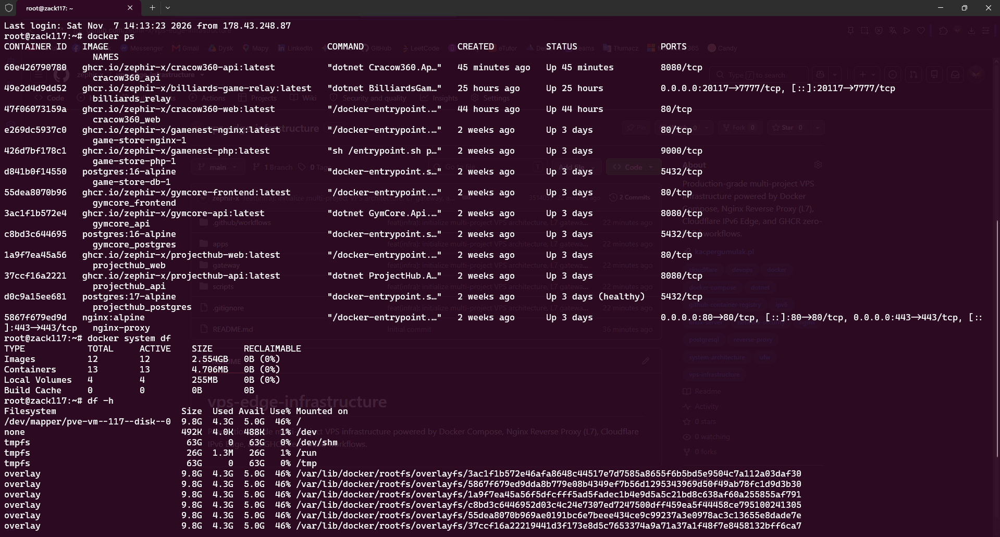
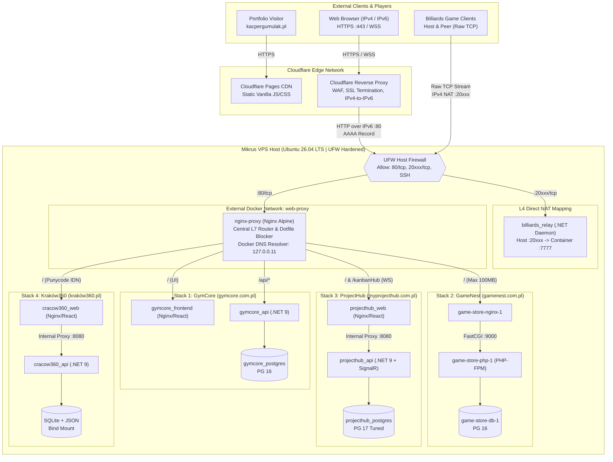
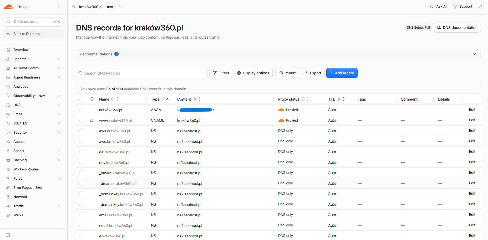
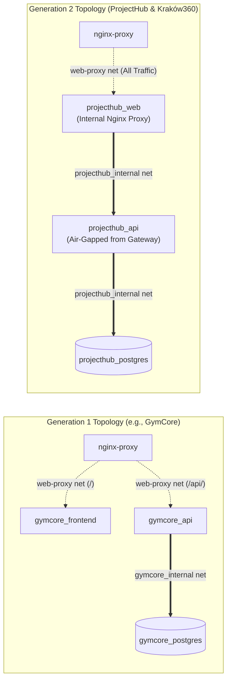
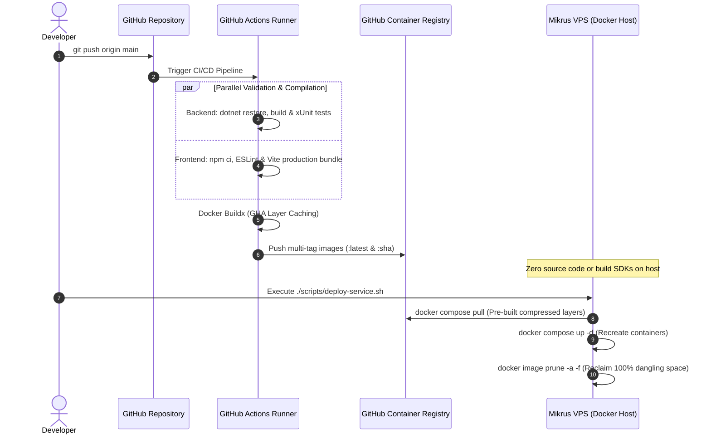
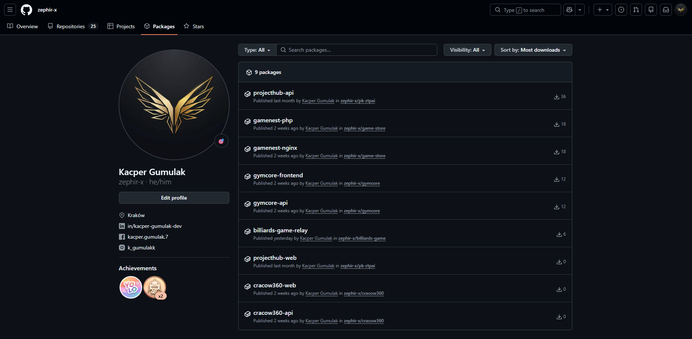
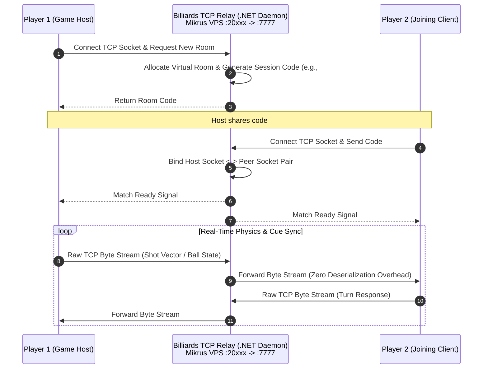

<div align="center">

# Production Multi-Project VPS Edge Infrastructure
### Self-Hosted PaaS Architecture | L7 Reverse Proxy & L4 TCP Relay | Zero-Build CI/CD

[](https://ubuntu.com/)
[](https://docs.docker.com/compose/)
[](https://nginx.org/)
[](https://www.cloudflare.com/)
[](https://github.com/features/packages)
[](https://dotnet.microsoft.com/)

<p align="center">
  An engineering case study and configuration blueprint demonstrating how to run <strong>13 production containers</strong> (4 full-stack web platforms, 3 PostgreSQL instances, 1 SQLite engine, and a custom L4 TCP game relay daemon) within a strict <strong>9.8 GB disk quota</strong> and low-memory Linux VPS environment.
</p>

[Live Portfolio](https://kacpergumulak.pl) • [System Architecture](#2-high-level-network--traffic-architecture) • [Zero-Build CI/CD](#5-zero-build-production-paradigm-cicd--ghcr) • [Security Post-Mortem](#7-security-hardening--incident-post-mortem)

</div>

---

## Table of Contents
1. [Executive Summary & Engineering Context](#1-executive-summary--engineering-context)
2. [High-Level Network & Traffic Architecture](#2-high-level-network--traffic-architecture)
3. [Hosted Production Systems & Ecosystem](#3-hosted-production-systems--ecosystem)
4. [Evolution of Container Network Isolation](#4-evolution-of-container-network-isolation)
5. [Zero-Build Production Paradigm (CI/CD & GHCR)](#5-zero-build-production-paradigm-cicd--ghcr)
6. [Low-Footprint Resource Tuning (.NET & PostgreSQL)](#6-low-footprint-resource-tuning-net--postgresql)
7. [Security Hardening & Incident Post-Mortem](#7-security-hardening--incident-post-mortem)
8. [Custom L4 TCP Game Relay Architecture](#8-custom-l4-tcp-game-relay-architecture)
9. [Repository Structure & Operational Workflows](#9-repository-structure--operational-workflows)

---

## 1. Executive Summary & Engineering Context

Deploying multiple full-stack applications to managed cloud services (e.g., Azure App Services, AWS ECS) quickly scales into significant monthly costs. Conversely, hosting numerous independent systems on a budget-friendly Virtual Private Server (Mikrus VPS) introduces strict hardware and networking constraints:
* **Storage Ceiling:** A hard `9.8 GB` root filesystem limit (`/dev/mapper/pve-vm`), leaving zero room for local SDKs, compiler caches, or dangling Docker layers.
* **Network Topology (IPv4 CGNAT vs. Routable IPv6):** The VPS operates behind a shared IPv4 NAT with only two dedicated high-range TCP/UDP ports (`20xxx`, `30xxx`), while exposing a dedicated, publicly routable `/128` IPv6 address.
* **Multi-Runtime Density:** Running concurrent `.NET 9` APIs, `PHP-FPM` workers, `React` SPAs, and multiple `PostgreSQL 16/17` engines without triggering the Linux kernel Out-Of-Memory (OOM) killer.

This repository documents the production infrastructure, L7/L4 routing rules, memory optimizations, and security mitigations engineered to solve these constraints.



---

## 2. High-Level Network & Traffic Architecture

The infrastructure splits incoming traffic into two distinct OSI pathways:
1. **Layer 7 (HTTP/HTTPS & WebSockets):** Public domains use Cloudflare DNS configured with `AAAA` records pointing directly to the server's public IPv6 address (`2a01:4f9:3a:xxxx::117`). Cloudflare acts as an IPv4-to-IPv6 gateway, DDoS shield, and SSL terminator (Flexible SSL), forwarding clean HTTP requests over IPv6 Port `80` to the central `nginx-proxy` container.
2. **Layer 4 (Raw TCP Socket Stream):** Real-time multiplayer game traffic bypasses HTTP proxies entirely, connecting directly via the VPS provider's IPv4 NAT port forwarding (`20xxx/tcp`) to a containerized `.NET` TCP relay daemon.





---

## 3. Hosted Production Systems & Ecosystem

All domain-backed services are routed through the VPS gateway, except for the personal portfolio site which is deliberately offloaded to **Cloudflare Pages** to save server resources for stateful workloads.

| System | Public Domain / Endpoint | Tech Stack | Architectural Highlights |
| :--- | :--- | :--- | :--- |
| **Kraków360** | [kraków360.pl](https://kraków360.pl)<br/>*(`xn--krakw360-y3a.pl`)* | `.NET 9 Minimal API`, `React`, `Leaflet`, `SQLite`, `DeepSeek AI` | Internationalized Domain Name (IDN Punycode) routing; strictly isolated backend container; read-only JSON contract bind mounts. |
| **ProjectHub** | [myprojecthub.com.pl](https://myprojecthub.com.pl) | `.NET 9`, `React`, `TypeScript`, `SignalR`, `PostgreSQL 17` | Full-duplex WebSocket connection upgrade (`/kanbanHub`) with 3600s keep-alive timeouts; custom PostgreSQL buffer tuning; healthcheck-gated startup. |
| **GymCore** | [gymcore.com.pl](https://gymcore.com.pl) | `.NET 9`, `CQRS`, `React`, `Stripe API`, `DeepSeek AI`, `PostgreSQL 16` | Path-based L7 split routing (`/` to SPA container, `/api/` directly to Kestrel backend); webhook signature verification. |
| **GameNest** | [gamenest.com.pl](https://gamenest.com.pl) | `Custom PHP MVC`, `PHP-FPM`, `Nginx`, `PostgreSQL 16` | Shared Docker volume (`gamenest_uploads`) mounted across Nginx and PHP-FPM containers; custom `100MB` body size limit for game archive uploads. |
| **Billiards Relay** | `<vps-host>:20xxx/tcp` | `.NET 9 Socket Daemon` | Custom Layer 4 TCP packet relay solving NAT traversal for P2P multiplayer sessions via dynamic room codes. |
| **Developer Portfolio** | [kacpergumulak.pl](https://kacpergumulak.pl)<br/>*([GitHub Repo](https://github.com/zephir-x/portfolio-site))* | `Vanilla JS`, `HTML5`, `CSS3 Glassmorphism`, `JSON i18n` | Hosted externally on **Cloudflare Pages** (Edge CDN) as a zero-dependency SPA, decoupling static branding from VPS uptime. |

---

## 4. Evolution of Container Network Isolation

A closer inspection of `gateway/nginx.conf` and the `apps/*/docker-compose.yml` files reveals two distinct networking patterns. Rather than refactoring legacy stacks blindly, the infrastructure documents a deliberate architectural evolution across project generations:



### Generation 1: Shared Gateway Network (`GymCore`)
In the earliest deployment, both `gymcore_frontend` and `gymcore_api` were attached to the external `web-proxy` network. The central `nginx-proxy` performed path-based routing (`location /api/` vs `location /`).
* **Drawback:** Attaching the backend API container directly to the shared `web-proxy` bridge meant that any other compromised container on `web-proxy` could potentially probe `gymcore_api:8080` laterally.

### Generation 2: Double Reverse Proxy & Strict Backend Air-Gapping (`ProjectHub` & `Kraków360`)
In newer systems, **only the frontend Nginx container** (`projecthub_web`, `cracow360_web`) is attached to the shared `web-proxy` network. The `.NET 9` backend APIs and databases reside exclusively inside isolated project bridges (`projecthub_internal`, `cracow360_internal`).
* **Benefit:** The backend API is completely invisible to the main gateway and other hosted projects. The frontend container serves static React files and proxies `/api` or `/kanbanHub` requests internally across the private bridge.

### Dynamic DNS Resolution in Nginx (`127.0.0.11`)
By default, Nginx resolves upstream hostnames only once during startup. If a single application container is down for maintenance when `nginx-proxy` boots, Nginx fails with `host not found in upstream` and crashes all 4 domains.
To prevent cascading outages, every location block utilizes Docker's embedded DNS server (`127.0.0.11`) paired with runtime variable evaluation:
```nginx
resolver 127.0.0.11 valid=30s;
set $upstream_cracow_web http://cracow360_web:80;
proxy_pass $upstream_cracow_web;
```
This forces Nginx to start regardless of upstream availability and re-resolve container IPs dynamically every 30 seconds.

---

## 5. Zero-Build Production Paradigm (CI/CD & GHCR)

Compiling `.NET 9` solutions or running `npm run build` (Vite/TypeScript) directly on a budget VPS spikes CPU load to 100%, exhausts RAM, and leaves behind gigabytes of NuGet/npm caches and intermediate Docker layers.

To maintain a clean `4.3 GB / 9.8 GB` disk footprint, the server strictly follows a **Zero-Build Production Paradigm**: **zero source code, zero compilers, and zero `Dockerfile` builds exist on the production host.**





---

## 6. Low-Footprint Resource Tuning (.NET & PostgreSQL)

Running 13 containers simultaneously requires overriding default enterprise configurations in both `.NET` and `PostgreSQL`, which otherwise assume dedicated multi-core hardware.

### 1. Disabling .NET Server Garbage Collection (`DOTNET_gcServer=0`)
By default, ASP.NET Core running inside a container enables **Server GC**, allocating independent managed heaps per logical CPU core and aggressively reserving memory before triggering garbage collection.
* **Optimization:** Setting `DOTNET_gcServer=0` forces the runtime into **Workstation GC** mode. The garbage collector runs on a single heap with frequent, low-latency collections, keeping `.NET 9` API memory usage stably between **45 MB and 90 MB** under load.

### 2. PostgreSQL 17 Shared Buffer & Connection Capping
Standard PostgreSQL images allocate `128 MB+` for `shared_buffers` and allow `100` concurrent connections (each spawning an OS process consuming overhead memory). In `apps/projecthub/docker-compose.yml`, the database engine is explicitly tuned at launch:
```yaml
command: postgres -c shared_buffers=64MB -c work_mem=4MB -c max_connections=30
```

### 3. Hard Cgroup Memory Ceilings
Modern stacks enforce strict Docker cgroup limits (`deploy.resources.limits.memory`) so a memory leak or heavy AI payload in a single microservice never starves sibling containers:

| Service Role | Assigned Memory Ceiling | Runtime Optimization Applied |
| :--- | :---: | :--- |
| **PostgreSQL 17 (`projecthub_postgres`)** | `192 MB` | Custom `shared_buffers=64MB`, `work_mem=4MB`, Alpine base |
| **.NET 9 Backend APIs (`projecthub_api`, `cracow360_api`)** | `192 MB - 256 MB` | `DOTNET_gcServer=0` (Workstation GC), Release AOT/Trimmed layers |
| **Nginx SPA Frontends (`projecthub_web`, `cracow360_web`)** | `64 MB` | Lightweight `nginx:alpine` serving pre-bundled static assets |
| **L4 TCP Relay Daemon (`billiards_relay`)** | `64 MB` (`0.50 CPU`) | Raw socket multiplexing, `DOTNET_gcServer=0`, log rotation (`3x10MB`) |

---

## 7. Security Hardening & Incident Post-Mortem

Production engineering is defined by how systems evolve after failure. During an earlier iteration of this infrastructure, a security incident occurred on one of the hosted projects. Below is the transparent post-mortem and the defense-in-depth architecture implemented in response.

### Incident Post-Mortem: Environment & Token Exposure
* **Root Cause:** An early configuration of the PHP-based application (`GameNest`) suffered from a path-resolution misconfiguration before central gateway rules were standardized. Automated vulnerability scanners exploited this to read environment variables (`.env`), exposing database credentials and a GitHub Personal Access Token (PAT) stored on the host.
* **Immediate Remediation:**
    1. Revoked and rotated all GitHub tokens, GHCR credentials, and application secrets immediately.
    2. Audited running processes, crontab entries, and `/root/.ssh/authorized_keys` to rule out persistent backdoors.
    3. Rebuilt container volumes with fresh database passwords.

### Defense-in-Depth Mitigations Implemented

1. **Global Dotfile Blocking at the L7 Gateway (`gateway/nginx.conf`):**
   Every virtual host on the central `nginx-proxy` enforces a strict regex block rejecting any request targeting hidden files or directories (`.env`, `.git`, `.htaccess`) before the packet ever reaches an application container:
   ```nginx
   server_tokens off;
   location ~ /\. {
       deny all;
   }
   ```
2. **Elimination of Host-Bound Database Ports (Docker vs. UFW Bypass Prevention):**
   A well-known Linux pitfall is that publishing ports via `ports: - "5432:5432"` in Docker Compose modifies `iptables` `PREROUTING` chains directly, bypassing `ufw` host firewall rules. In this infrastructure, **zero databases or internal APIs declare a `ports:` directive**. Only `nginx-proxy` (`80/tcp`) and `billiards_relay` (`20xxx/tcp`) bind to the host network interface.
3. **SSH Key-Only Authentication & Non-Standard NAT Port:**
   Password-based authentication is completely disabled in `/etc/ssh/sshd_config` (`PasswordAuthentication no`). Administrative access requires an Ed25519/RSA private key over a dedicated NAT port.
4. **Host-Level UFW Baseline (`scripts/firewall-hardening.sh`):**
   Default incoming policy is set to `deny`, explicitly whitelisting only SSH, HTTP/HTTPS edge ports, and the designated L4 TCP relay port across IPv4 and IPv6.

---

## 8. Custom L4 TCP Game Relay Architecture

Home broadband connections and mobile networks place players behind Carrier-Grade NAT (CGNAT) and restrictive firewalls, making direct Peer-to-Peer (P2P) socket connections impossible without complex STUN/TURN hole-punching.

To power a custom multiplayer **Billiards Game**, the VPS hosts a lightweight `.NET` TCP Relay microservice (`apps/billiards-relay`):



* **Zero Serialization Overhead:** Once two sockets are paired via a room code, the daemon acts as a bidirectional byte-stream pipe at Layer 4, forwarding packets in memory without parsing game-state JSON, resulting in minimal CPU footprint (`< 0.50 vCPU`) and sub-millisecond relay latency.

---

## 9. Repository Structure & Operational Workflows

```text
vps-edge-infrastructure/
├── .github/
│   └── workflows/
│       └── ghcr-build-template.yml   # Reference CI/CD pipeline building images off-server to GHCR
├── apps/
│   ├── billiards-relay/
│   │   └── docker-compose.yml        # L4 TCP multiplayer game relay service (.NET)
│   ├── cracow360/
│   │   ├── data/
│   │   │   └── .gitkeep              # Directory structure for SQLite DB & read-only JSON contracts
│   │   ├── .env.example              # Sanitized environment variables template
│   │   └── docker-compose.yml        # Gen-2 isolated stack (SQLite + .NET 9 + React)
│   ├── game-store/
│   │   ├── .env.example
│   │   └── docker-compose.yml        # PHP-FPM + Nginx + PostgreSQL 16 with shared upload volume
│   ├── gymcore/
│   │   ├── .env.example
│   │   └── docker-compose.yml        # Gen-1 stack (.NET 9 + React + PG 16 + Stripe/DeepSeek)
│   └── projecthub/
│       ├── .env.example
│       └── docker-compose.yml        # Gen-2 stack with SignalR WebSockets & tuned PG 17
├── gateway/
│   ├── docker-compose.yml            # Central nginx-proxy container definition
│   └── nginx.conf                    # Virtual hosts, dynamic DNS resolver, WS upgrade, security rules
├── scripts/
│   ├── deploy-service.sh             # Automated pull, recreate, image prune, and disk audit script
│   └── firewall-hardening.sh         # UFW ruleset initialization & SSH configuration check
├── .gitignore                        # Prevents committing live .env files, keys, and SQLite databases
└── README.md                         # Architecture documentation and engineering case study
```

### Bootstrapping the Infrastructure on a Fresh Host

1. **Create the shared external gateway network:**
   ```bash
   docker network create web-proxy
   ```
2. **Apply host firewall and SSH baseline:**
   ```bash
   chmod +x scripts/*.sh
   sudo ./scripts/firewall-hardening.sh
   ```
3. **Launch the central L7 Nginx Gateway:**
   ```bash
   cd gateway && docker compose up -d
   ```
4. **Configure environment variables and deploy an application stack:**
   ```bash
   cp apps/projecthub/.env.example apps/projecthub/.env
   # Edit apps/projecthub/.env with production secrets
   ./scripts/deploy-service.sh apps/projecthub
   ```

---

<div align="center">
  <sub>Designed, maintained, and documented by <strong>Kacper Gumulak</strong> • <a href="https://kacpergumulak.pl">kacpergumulak.pl</a></sub>
</div>